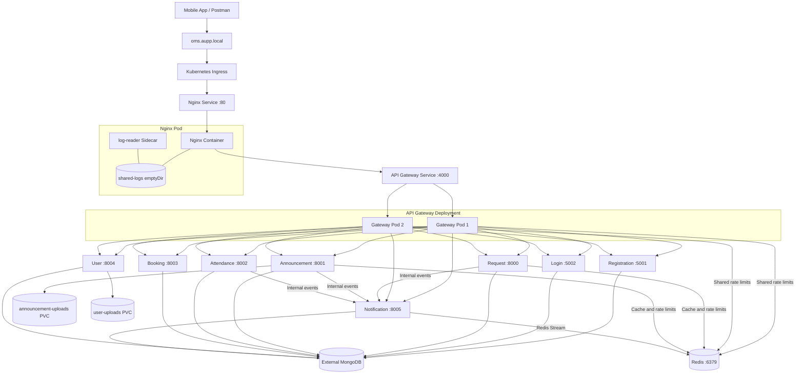

<div align="center">

# American University of Phnom Penh

<br><br>

# PROJECT NAME

## Organization Management System (OMS): Cloud-Native Microservice Backend

<br><br><br>

# MEMBER NAME

| Member name | Student ID |
| --- | --- |
| _Add member name_ | _Add student ID_ |
| _Add member name_ | _Add student ID_ |
| _Add member name_ | _Add student ID_ |

<br><br><br>

**CLD 376 – Cloud Native Development**<br>
**Prof. Chandan Mukherjee**<br>
**Fall 2026**

</div>

\newpage

# Table of Contents

> Update page numbers after exporting this report to PDF.

1. [Introduction](#1-introduction)
2. [Objective](#2-objective)
3. [Architecture Diagram](#3-architecture-diagram)
4. [Technologies / Tools](#4-technologies--tools)
5. [Microservice Details](#5-microservice-details)
6. [POD and Container Details](#6-pod-and-container-details)
7.1. [Deployment YAML File](#71-deployment-yaml-file)
7.2. [Service YAML File](#72-service-yaml-file)
8. [Fanout Mechanism](#8-fanout-mechanism)
9. [Volume Implementation](#9-volume-implementation)
10. [Postman API Calls – All Screenshots](#10-postman-api-calls--all-screenshots)
11. [GitHub Link](#11-github-link)
12. [Individual Contribution (For Group)](#12-individual-contribution-for-group)

# 1. Introduction

Organization Management System (OMS) is a REST microservice backend for registration, login, leave requests, announcements, attendance, notifications, user profiles/documents, and room booking. The project deploys on Minikube through Kubernetes YAML manifests and connects to external MongoDB.

The public URL is `http://oms.aupp.local`. Kubernetes Ingress forwards requests to Nginx. Nginx forwards requests to the API Gateway Service, and the Gateway routes requests to internal business services. Redis provides shared Gateway rate limiting, Request and Announcement caching/rate limiting, and Notification Service event transport.

# 2. Objective

The objectives of this project are to:

1. Develop a REST backend using independent Node.js/Express and Python/FastAPI microservices.
2. Deploy the services as Kubernetes workloads on Minikube.
3. Expose one public hostname through Kubernetes Ingress and Nginx.
4. Keep business services private with `ClusterIP` Services.
5. Demonstrate Gateway load balancing with two API Gateway replicas.
6. Use external MongoDB for persistent application data.
7. Use PersistentVolumeClaims for uploaded announcement and user-document files.
8. Demonstrate shared storage between two containers in the Nginx Pod.
9. Verify public workflows through Postman.

# 3. Architecture Diagram



> **Screenshot / diagram placeholder:** Insert the final architecture diagram here. It must show Ingress, Nginx, both API Gateway replicas, internal services, Redis, external MongoDB, PVCs, and the shared Nginx log volume.

# 4. Technologies / Tools

| Technology / Tool | Use in OMS |
| --- | --- |
| Kubernetes | Deployments, Services, Ingress, ConfigMaps, Secrets, and PersistentVolumeClaims |
| Minikube | Local Kubernetes cluster |
| `kubectl` | Deploying and inspecting Kubernetes resources |
| Kustomize | Combines non-secret resources through `deploy/k8s/kustomization.yaml` |
| Docker | Builds application images in the Minikube image store |
| Node.js / Express | API Gateway, Registration, Login, Attendance, and Notification services |
| Python 3.12 / FastAPI | Request, Announcement, User, and Booking services |
| MongoDB | External persistent application database |
| Redis | Shared Gateway rate limiting, service caching/rate limiting, and notification event transport |
| Nginx | Public reverse proxy and Gateway load balancer |
| Postman | Public API verification |
| GitHub | Source control and repository hosting |

# 5. Microservice Details

## 5.1 Name and Running Port Number

| Component | Kubernetes Service name | Port | Replicas | Responsibility |
| --- | --- | ---: | ---: | --- |
| Nginx | `nginx` | 80 | 1 | Internal reverse proxy and shared-log producer |
| API Gateway | `api-gateway` | 4000 | 2 | Route proxy, JWT middleware, and shared Redis-backed rate limiting |
| Registration Service | `registration-service` | 5001 | 1 | Account creation and password hashing |
| Login Service | `login-service` | 5002 | 1 | Credential validation and JWT issuance |
| Request Service | `request-service` | 8000 | 1 | Leave-request workflow |
| Announcement Service | `announcement-service` | 8001 | 1 | Announcement management and uploads |
| Attendance Service | `attendance-service` | 8002 | 1 | Check-in, check-out, and corrections |
| Booking Service | `booking-service` | 8003 | 1 | Room and booking workflow |
| User Service | `user-service` | 8004 | 1 | Profiles and protected documents |
| Notification Service | `notification-service` | 8005 | 1 | In-app notifications and preferences |
| Redis | `redis` | 6379 | 1 | Shared rate limiting, service caching, and internal event transport |

Only Nginx is exposed through Ingress. The Gateway and all business services use internal Kubernetes Service DNS names. Public requests follow Ingress → Nginx → API Gateway.

The API Gateway validates JWTs for protected prefixes. Each business service is the authority for role, ownership, and business authorization checks; this keeps endpoint-specific authorization alongside the resource it protects.

## 5.2 API Details for Each Microservice

All paths below are public Gateway paths relative to `http://oms.aupp.local`, unless marked **internal**. `JWT` means `Authorization: Bearer <token>` is required.

### API Gateway

| Method | Path | Auth | Purpose / expected result |
| --- | --- | --- | --- |
| GET | `/health` | None | Gateway liveness response (`200`) and `X-Gateway-Instance` header. |

### Registration Service

| Method | Path | Auth | Purpose / expected result |
| --- | --- | --- | --- |
| POST | `/register` | None | Creates an account; returns `201`. |
| GET | `/register/health` | None | Service health response. |
| POST | `/register/internal/users` | Internal API key; not gateway workflow | Creates an account for the User Service. |
| PATCH | `/register/internal/users/{id}` | Internal API key; not gateway workflow | Updates an internal account. |

### Login Service

| Method | Path | Auth | Purpose / expected result |
| --- | --- | --- | --- |
| POST | `/login` | None | Validates credentials and returns a JWT (`200`). |
| GET | `/login/health` | None | Service health response. |

### Request Service

| Method | Path | Auth | Purpose / expected result |
| --- | --- | --- | --- |
| GET | `/request/health` | None | Service health response. |
| POST | `/request/leave-requests` | JWT | Creates a leave request (`201`). |
| GET | `/request/leave-requests` | JWT | Lists accessible leave requests. |
| GET | `/request/leave-requests/{requestId}` | JWT | Retrieves one accessible leave request. |
| PATCH | `/request/leave-requests/{requestId}` | JWT, owner | Updates a pending leave request. |
| PATCH | `/request/leave-requests/{requestId}/cancel` | JWT, owner | Cancels a pending leave request. |
| POST | `/request/leave-requests/{requestId}/approve` | JWT, admin | Approves a pending leave request. |
| POST | `/request/leave-requests/{requestId}/reject` | JWT, admin | Rejects a pending leave request. |

### Announcement Service

| Method | Path | Auth | Purpose / expected result |
| --- | --- | --- | --- |
| GET | `/announcement/health` | None | Service health response. |
| POST | `/announcement/` | JWT, admin | Creates an announcement (`201`). |
| GET | `/announcement/` | JWT | Lists published announcements for users; admins may filter by status. |
| GET | `/announcement/all` | JWT, admin | Lists all announcements, including drafts. |
| GET | `/announcement/{announcementId}` | JWT | Retrieves a published announcement; admins may retrieve drafts. |
| PATCH | `/announcement/{announcementId}` | JWT, admin | Updates an announcement. |
| DELETE | `/announcement/{announcementId}` | JWT, admin | Deletes an announcement (`204`). |

### Attendance Service

| Method | Path | Auth | Purpose / expected result |
| --- | --- | --- | --- |
| GET | `/attendance/health` | None | Service health response. |
| POST | `/attendance/check-in` | JWT | Creates a caller attendance session. A second check-in is allowed after checkout; only one session may be open per `Asia/Phnom_Penh` day. |
| POST | `/attendance/check-out` | JWT | Records the caller's check-out for the open attendance session. |
| GET | `/attendance/me` | JWT | Lists the caller's attendance history. |
| POST | `/attendance/` | JWT, admin | Creates an attendance record. |
| GET | `/attendance/` | JWT, admin | Lists attendance records. |
| GET | `/attendance/{id}` | JWT | Retrieves an attendance record. |
| PATCH | `/attendance/{id}` | JWT, admin | Corrects an attendance record. |
| DELETE | `/attendance/{id}` | JWT, admin | Deletes an attendance record. |

### Booking Service

| Method | Path | Auth | Purpose / expected result |
| --- | --- | --- | --- |
| GET | `/booking/health` | None | Service health response. |
| POST | `/booking/rooms` | JWT, admin | Creates a room (`201`). |
| GET | `/booking/rooms` | JWT | Lists rooms. |
| GET | `/booking/rooms/{roomId}` | JWT | Retrieves a room. |
| PATCH | `/booking/rooms/{roomId}` | JWT, admin | Updates a room. |
| DELETE | `/booking/rooms/{roomId}` | JWT, admin | Deactivates a room (`204`). |
| GET | `/booking/rooms/{roomId}/availability` | JWT | Lists busy slots in a requested time window. |
| POST | `/booking/` | JWT | Creates a booking (`201`). |
| GET | `/booking/me` | JWT | Lists the caller's bookings. |
| GET | `/booking/` | JWT, admin | Lists all bookings. |
| GET | `/booking/{bookingId}` | JWT | Retrieves an accessible booking. |
| POST | `/booking/{bookingId}/cancel` | JWT | Cancels an accessible active booking. |
| POST | `/booking/{bookingId}/approve` | JWT, admin | Approves a pending booking. |
| POST | `/booking/{bookingId}/reject` | JWT, admin | Rejects a pending booking. |

### User Service

| Method | Path | Auth | Purpose / expected result |
| --- | --- | --- | --- |
| GET | `/user/health` | None | Service health response. |
| GET | `/user/me` | JWT | Gets or creates the caller's profile. |
| PATCH | `/user/me` | JWT | Updates the caller's profile. |
| GET | `/user/` | JWT, admin | Lists user profiles. |
| POST | `/user/` | JWT, admin | Creates a user profile and account (`201`). |
| GET | `/user/{userId}` | JWT, self or admin | Retrieves a profile. |
| PATCH | `/user/{userId}` | JWT, admin | Updates a profile and account fields. |
| DELETE | `/user/{userId}` | JWT, admin | Deactivates a user (`204`). |
| POST | `/user/me/documents` | JWT | Uploads a PDF, JPEG, PNG, or WEBP document (`201`). |
| GET | `/user/me/documents` | JWT | Lists the caller's documents. |
| GET | `/user/me/documents/{documentId}/download` | JWT | Downloads the caller's document. |
| GET | `/user/{userId}/documents` | JWT, self or admin | Lists a user's documents. |
| GET | `/user/{userId}/documents/{documentId}/download` | JWT, self or admin | Downloads a user's document. |

### Notification Service

| Method | Path | Auth | Purpose / expected result |
| --- | --- | --- | --- |
| GET | `/notification/health` | None | Returns notification/Redis health. |
| GET | `/notification/` | JWT | Lists notifications visible to the caller. |
| POST | `/notification/` | JWT, admin | Creates a notification (`201`). |
| GET | `/notification/unread-count` | JWT | Returns the unread notification count. |
| GET | `/notification/{notificationId}` | JWT | Retrieves an accessible notification. |
| PATCH | `/notification/read-all` | JWT | Marks all accessible notifications as read. |
| PATCH | `/notification/{notificationId}/read` | JWT | Marks one notification as read. |
| PATCH | `/notification/{notificationId}` | JWT, admin | Updates a notification. |
| DELETE | `/notification/{notificationId}` | JWT | Hides a notification for the caller; admins delete globally. |
| GET | `/notification/preferences/me` | JWT | Retrieves the caller's preferences. |
| PATCH | `/notification/preferences/me` | JWT | Updates the caller's preferences. |
| POST | `/notification/internal/events` | Internal API key; not gateway workflow | Receives service-to-service notification events. |

# 6. POD and Container Details

| Deployment | Pod replicas | Container name(s) | Image(s) | Port(s) | Configuration / volume details |
| --- | ---: | --- | --- | --- | --- |
| `nginx` | 1 | `nginx`, `log-reader` | `nginx:1.27-alpine`, `busybox:1.36` | 80 | ConfigMap-mounted Nginx config; both containers mount `shared-logs` `emptyDir`. |
| `api-gateway` | 2 | `api-gateway` | `oms-api-gateway:latest` | 4000 | Loads `oms-config` and `oms-secrets`; `/health` readiness probe. |
| `registration-service` | 1 | `registration-service` | `oms-registration-service:latest` | 5001 | Loads shared ConfigMap and Secret; `/health` readiness probe. |
| `login-service` | 1 | `login-service` | `oms-login-service:latest` | 5002 | Loads shared ConfigMap and Secret; `/health` readiness probe. |
| `request-service` | 1 | `request-service` | `oms-request-service:latest` | 8000 | Loads shared ConfigMap and Secret; `/health` readiness probe. |
| `announcement-service` | 1 | `announcement-service` | `oms-announcement-service:latest` | 8001 | Loads ConfigMap/Secret; mounts `announcement-uploads`; `/health` readiness probe. |
| `attendance-service` | 1 | `attendance-service` | `oms-attendance-service:latest` | 8002 | Loads ConfigMap/Secret; `/health` readiness probe. |
| `booking-service` | 1 | `booking-service` | `oms-booking-service:latest` | 8003 | Loads ConfigMap/Secret; `/health` readiness probe. |
| `user-service` | 1 | `user-service` | `oms-user-service:latest` | 8004 | Loads ConfigMap/Secret; mounts `user-uploads`; `/health` readiness probe. |
| `notification-service` | 1 | `notification-service` | `oms-notification-service:latest` | 8005 | Loads ConfigMap/Secret; `/health` readiness probe. |
| `redis` | 1 | `redis` | `redis:7-alpine` | 6379 | Runs without disk persistence for shared rate limits, service caches, and event transport. |

Use the following commands during the demonstration:

```bash
kubectl get deployments,pods,services,ingress,pvc -n oms
kubectl describe pod -n oms <pod-name>
kubectl logs -n oms deployment/api-gateway
```

> **Screenshot placeholder:** Insert the Pod list, a selected Pod description, and relevant container logs here.

# 7.1 Deployment YAML File

Deployment YAML files are in `deploy/k8s/components/<component>/deployment.yaml`. A Deployment sets the desired replicas, labels, image, ports, environment sources, readiness probes, and volume mounts.

The following is the active API Gateway Deployment structure from `deploy/k8s/components/api-gateway/deployment.yaml`:

```yaml
apiVersion: apps/v1
kind: Deployment
metadata:
  name: api-gateway
  namespace: oms
spec:
  replicas: 2
  selector:
    matchLabels:
      app: api-gateway
  template:
    metadata:
      labels:
        app: api-gateway
    spec:
      containers:
        - name: api-gateway
          image: oms-api-gateway:latest
          imagePullPolicy: IfNotPresent
          ports:
            - containerPort: 4000
          envFrom:
            - configMapRef: { name: oms-config }
            - secretRef: { name: oms-secrets }
          readinessProbe:
            httpGet: { path: /health, port: 4000 }
            initialDelaySeconds: 5
```

| YAML field | Meaning in this project |
| --- | --- |
| `replicas: 2` | Starts two Gateway Pods for the load-balancing requirement. |
| `matchLabels` / `labels` | Connects the Deployment Pods to the `api-gateway` Service selector. |
| `imagePullPolicy: IfNotPresent` | Uses images built locally by `scripts/build-minikube-images.sh`. |
| `envFrom` | Loads non-sensitive values from `oms-config` and sensitive values from `oms-secrets`. |
| `readinessProbe` | Prevents traffic from reaching the Pod until `/health` responds successfully. |

> **Screenshot placeholder:** Insert selected active Deployment YAML screenshots here, including Gateway, Nginx, and one PVC-consuming service.

Recommended evidence, rather than screenshots of every repetitive Deployment file:

1. `kubectl get deployments -n oms` to prove all Deployments are running.
2. `deploy/k8s/components/api-gateway/deployment.yaml` to show two replicas, `envFrom`, and readiness probe.
3. `deploy/k8s/components/nginx/deployment.yaml` to show the two containers and `shared-logs` volume.
4. Either `announcement-service/deployment.yaml` or `user-service/deployment.yaml` to show a PVC mount.

# 7.2 Service YAML File

Service YAML files are in `deploy/k8s/components/<component>/service.yaml`. A Service gives Pods a stable DNS name and routes traffic to Pods with matching labels.

The following is the active API Gateway Service structure from `deploy/k8s/components/api-gateway/service.yaml`:

```yaml
apiVersion: v1
kind: Service
metadata:
  name: api-gateway
  namespace: oms
spec:
  selector:
    app: api-gateway
  ports:
    - port: 4000
      targetPort: 4000
```

| YAML field | Meaning in this project |
| --- | --- |
| `name: api-gateway` | Creates the internal hostname `api-gateway.oms.svc.cluster.local`. |
| `selector: app: api-gateway` | Selects both ready Gateway Pods. |
| `port` / `targetPort` | Routes Service port 4000 to container port 4000. |
| Default Service type | Keeps Gateway and business services internal (`ClusterIP`). |

The Nginx Service is the Ingress backend and uses `ClusterIP`, like the Gateway and business services. Ingress is the only public entry point.

> **Screenshot placeholder:** Insert selected active Service YAML screenshots and `kubectl get services -n oms` output here.

Recommended evidence, rather than screenshots of every repetitive Service file:

1. `kubectl get services -n oms` to prove all Services and ports.
2. `deploy/k8s/components/api-gateway/service.yaml` to show the Service selector and port mapping.
3. `deploy/k8s/components/nginx/service.yaml` to show the internal `ClusterIP` Ingress backend.

# 8. Fanout Mechanism

The project uses the local Fanout DNS hostname `oms.aupp.local`. Map it to the Minikube IP:

```bash
echo "$(minikube ip) oms.aupp.local" | sudo tee -a /etc/hosts
```

On macOS with the Docker driver, the Minikube IP may not be reachable from the host. In that case, run `sudo minikube tunnel` in a separate terminal and keep it running. The tunnel exposes the public Ingress on `127.0.0.1`; map `oms.aupp.local` to `127.0.0.1` in `/etc/hosts`. This preserves the demonstrated Ingress path.

The request flow is:

```text
Client -> oms.aupp.local -> Ingress -> Nginx -> api-gateway Service -> Gateway Pod 1 or Gateway Pod 2
```

Nginx proxies to `api-gateway:4000`. The Kubernetes `api-gateway` Service selects two ready Gateway Pods, so it distributes requests between them. Verify this by making repeated public health requests and comparing the `X-Gateway-Instance` header:

```bash
for i in {1..8}; do
  curl -s -i http://oms.aupp.local/health | grep -i x-gateway-instance
done
```

> **Screenshot placeholder:** Insert the `/etc/hosts` mapping (and `minikube tunnel` evidence when required) and repeated health responses showing at least two distinct `X-Gateway-Instance` values.

# 9. Volume Implementation

## 9.1 Persistent volumes

| PersistentVolumeClaim | Mounted by | Mount path | Purpose |
| --- | --- | --- | --- |
| `announcement-uploads` | Announcement Service | `/backend/uploads` | Persists announcement uploads. |
| `user-uploads` | User Service | `/backend/uploads` | Persists protected user documents. |

Both claims request `1Gi` and use `ReadWriteOnce`. They are defined in `deploy/k8s/storage/` and require a default Minikube StorageClass or an explicitly configured `storageClassName`.

## 9.2 Shared volume between containers

The Nginx Pod defines `shared-logs` as an `emptyDir` volume. The Nginx container writes `/shared-logs/access.log`; the `log-reader` sidecar tails the same file:

```bash
kubectl logs -n oms deployment/nginx -c log-reader
```

`emptyDir` exists for the lifetime of the Pod, while PVC data is persistent beyond a Pod restart.

> **Screenshot placeholder:** Insert PVC status, an upload-persistence demonstration, and `log-reader` output here.

# 10. Postman API Calls – All Screenshots

Import these exported Postman files:

- `postman/OMS-Backend.postman_collection.json`
- `postman/OMS-local.postman_environment.json`

The environment default is `http://oms.aupp.local`. Run the collection only after Minikube, the Secret, and all Pods are ready. Redact passwords, full JWTs, MongoDB URIs, and API keys before adding screenshots.

| Screenshot group | Required public calls to show | Screenshot placeholder |
| --- | --- | --- |
| Gateway load balancing | `GET /health` repeated until two Gateway instance values appear | _Insert Screenshot 10.1_ |
| Registration and login | `POST /register`, `POST /login` | _Insert Screenshot 10.2_ |
| Leave requests | Create, list, get, update/cancel, approve/reject as applicable | _Insert Screenshot 10.3_ |
| Announcements | Create, list, get, update, delete; show an admin-only check | _Insert Screenshot 10.4_ |
| Attendance | Check in, check out, list mine, admin list/update | _Insert Screenshot 10.5_ |
| Notifications | List, unread count, read, read all, preferences | _Insert Screenshot 10.6_ |
| User profiles/documents | Profile get/update, document upload/list/download, admin user access | _Insert Screenshot 10.7_ |
| Booking | Room management, availability, create/list/get/cancel booking, approve/reject | _Insert Screenshot 10.8_ |
| Authorization errors | At least one protected endpoint without/with incorrect role token | _Insert Screenshot 10.9_ |
| Persistence | A public API record visible in configured cloud MongoDB | _Insert Screenshot 10.10_ |

> **Submission requirement:** Replace every placeholder above with the actual result screenshots after executing the calls. Do not claim a result that has not been run.

# 11. GitHub Link

Source repository:

<https://github.com/senghakch17-byte/AMT-MobileApp>

> **Submission placeholder:** Confirm repository visibility and replace this URL if a different final repository is submitted.

# 12. Individual Contribution (For Group)

| Member | Student ID | Contribution | Supporting evidence |
| --- | --- | --- | --- |
| _Add member_ | _Add student ID_ | _Describe implemented work_ | _Commit, pull request, screenshot, or report section_ |
| _Add member_ | _Add student ID_ | _Describe implemented work_ | _Commit, pull request, screenshot, or report section_ |
| _Add member_ | _Add student ID_ | _Describe implemented work_ | _Commit, pull request, screenshot, or report section_ |

> **Submission requirement:** Complete this table with each group member's actual contribution before submission.
