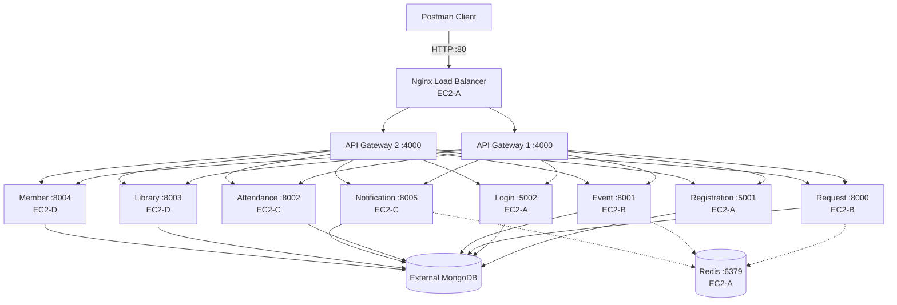

# OMS — Organization Management System

## Midterm Project Report

| Item | Details |
| --- | --- |
| Course | CLD 376 001 — Cloud Native Development |
| Instructor | MUKHERJEE, Chandan |
| Team members | Panhaseth SUY — 2024060; Senghak CHOEUN — 2024010; Sreypov THIM — 2024018 |
| Submission date | October 20, 2026 |
| Source code | <https://github.com/senghakch17-byte/AMT-MobileApp> |
| Demonstrated release | `ef758166ce71c61d726238a135b6fc40398cf061` |

---

## 1. Project Summary

OMS is a backend-only Organization Management System. It manages accounts, leave and scholarship requests, events, attendance, notifications, member profiles/documents, library rooms, bookings, and books. The system uses nine Dockerized microservices, an API Gateway, JWT authentication, role-based authorization, external MongoDB, and Nginx load balancing. No frontend is included.

### Roles

| Role | Main permissions |
| --- | --- |
| `user` | Register and log in; manage own requests, attendance, profile, documents, notifications, and bookings; view permitted events, rooms, and books. |
| `admin` | User permissions plus event, attendance, member, room, book, and booking administration. |

### Technology

| Area | Technology |
| --- | --- |
| Services and gateway | Node.js/Express and Python/FastAPI |
| Database | External MongoDB (Mongoose and Beanie) |
| Authentication | JWT, bcrypt, role-based authorization |
| Deployment | Docker Compose on EC2 |
| Public entry and load balancing | Nginx |
| API testing | Postman |

---

## 2. Team Ownership and Service Architecture

### 2.1 Member Service Ownership

> **Complete this table with the team's actual assignments before submission.** Each member must be responsible for two domain services.

| Team member | Student ID | Assigned microservice 1 | Assigned microservice 2 |
| --- | --- | --- | --- |
| Panhaseth SUY | 2024060 | **[Complete]** | **[Complete]** |
| Senghak CHOEUN | 2024010 | **[Complete]** | **[Complete]** |
| Sreypov THIM | 2024018 | **[Complete]** | **[Complete]** |

### 2.2 Architecture



### 2.3 EC2 Deployment Layout

| Host | Containers/services | Purpose |
| --- | --- | --- |
| EC2-A | Nginx, Gateway 1, Gateway 2, Registration, Login, Redis | Public entry point, load balancing, authentication, and internal Redis. |
| EC2-B | Request, Event | Request and event APIs. |
| EC2-C | Attendance, Notification | Attendance and notification APIs. |
| EC2-D | Library, Member | Library and member APIs. |
| External MongoDB | MongoDB | Persistent database; not created by Docker Compose. |

---

## 3. Microservice and API Summary

All public requests begin at:

```text
http://<EC2-A-PUBLIC-IP>
```

| Component | Host | Port | Gateway path | Main APIs / responsibility |
| --- | --- | ---: | --- | --- |
| Nginx | EC2-A | 80 | `/health` | Public reverse proxy and load balancer. |
| API Gateway (2 replicas) | EC2-A | 4000 | All public prefixes | JWT validation, role checks, and proxy routing. |
| Registration | EC2-A | 5001 | `/register` | `POST /register/register` creates a `user` account. |
| Login | EC2-A | 5002 | `/auth` | `POST /auth/login` validates credentials and issues JWT. |
| Request | EC2-B | 8000 | `/request` | Leave-request and scholarship-registration create/read/update/cancel APIs. |
| Event | EC2-B | 8001 | `/event` | Event create, list, read, update, and delete APIs. |
| Attendance | EC2-C | 8002 | `/attendance` | Check-in, check-out, personal history, and admin administration APIs. |
| Notification | EC2-C | 8005 | `/notification` | Notification, receipt, unread-count, and preference APIs. |
| Library | EC2-D | 8003 | `/library` | Room, booking, and book catalog APIs. |
| Member | EC2-D | 8004 | `/members` | Profile and protected document APIs. |

Detailed endpoint evidence is in **Appendix A**. Protected paths require `Authorization: Bearer <token>`.

---

## 4. Authentication and Role-Based Authorization

### Authentication Flow

1. A user registers through `POST /register/register`.
2. Registration hashes the password and assigns the `user` role; public registration cannot create an administrator.
3. User or administrator logs in through `POST /auth/login` and receives a one-hour JWT containing the user ID, email, and role.
4. The client sends the JWT in the `Authorization: Bearer <token>` header.
5. The API Gateway validates the JWT before proxying protected routes and blocks admin-only routes for `user` tokens.

### Authorization Evidence

| Test | Expected result |
| --- | --- |
| Incorrect email or password | `400 Invalid credentials` |
| Missing, malformed, or invalid JWT | `401 Unauthorized` |
| User token on an admin-only API | `403 Access Forbidden` |
| Admin token on an admin-only API | Successful authorized response |

> **Figure 1 — Registration and user login**  
> `[Insert readable Postman screenshots showing registration 201 and login 200 through the EC2-A public IP.]`

> **Figure 2 — Authentication and authorization failures**  
> `[Insert Postman screenshots for wrong credentials, invalid/missing JWT (401), and user token blocked from an admin API (403).]`

---

## 5. Database and CRUD

MongoDB is an external persistent database. Node.js services use Mongoose; Python services use Beanie and Pydantic validation.

| Collection / model | Service | Example data |
| --- | --- | --- |
| `persons` | Registration / Login | Name, email, password hash, phone, role. |
| `leave_requests`, `pre_scholarship_registrations` | Request | User ID, request details, status, timestamps. |
| `events` | Event | Title, category, dates, status, creator. |
| `attendances` | Attendance | `userID`, check-in/out details, status. |
| `notifications`, `notificationreceipts`, `notificationpreferences` | Notification | Recipient, delivery/receipt state, preferences. |
| `members`, `member_documents` | Member | Profile and protected-document metadata. |
| `rooms`, `bookings`, `books` | Library | Room, booking, and catalog data. |

Database rules include unique account email, unique room name, unique member profile per user, booking indexes for availability checks, and a partial unique index for book ISBN values.

> **Figure 3 — Collection names and schema code**  
> `[Insert readable MongoDB collection screenshot and schema-code screenshots. Split images by service if needed to keep code readable.]`

> **Figure 4 — MongoDB CRUD evidence**  
> `[Insert records created through Postman, such as a leave request, event, attendance record, booking, or member profile.]`

---

## 6. Docker, EC2, and Load Balancing

Each microservice has Docker build configuration. The EC2 Compose files divide the application across the four hosts shown in Section 2. Nginx is the only public application entry point; service ports, Redis, and MongoDB are restricted to required private traffic.

### 6.1 Deployment Evidence

The following evidence proves that all containers are running in the distributed deployment:

| Evidence | What it must prove |
| --- | --- |
| EC2 Console | EC2-A, EC2-B, EC2-C, and EC2-D are running. |
| EC2-A `docker compose ps` | Nginx, `gateway1`, `gateway2`, Registration, Login, and Redis are running. |
| EC2-B/C/D `docker compose ps` | Request/Event, Attendance/Notification, and Library/Member are running on their assigned hosts. |

> **Figure 5 — EC2 deployment and container status**  
> `[Insert readable EC2 Console and docker compose ps screenshots for all four hosts.]`

### 6.2 Nginx Load-Balancing Proof

Nginx uses two Gateway replicas in an upstream group:

```nginx
upstream gateways {
    server gateway1:4000;
    server gateway2:4000;
}

location / {
    proxy_pass http://gateways;
    add_header X-Upstream $upstream_addr always;
}
```

Nginx uses round-robin balancing by default. Repeated public `GET /health` requests must show two distinct `X-Upstream` values.

> **Figure 6 — Nginx load-balancer configuration and two Gateway replicas**  
> `[Insert readable nginx.conf and EC2-A container screenshots.]`

> **Figure 7 — Functional Nginx forwarding test**  
> `[Insert repeated Postman GET http://<EC2-A-PUBLIC-IP>/health responses. Each request must use the same public URL and show Server: nginx; show two distinct X-Upstream values, one for gateway1 and one for gateway2.]`

The changing `X-Upstream` response header is the proof that Nginx forwards public requests to **both** API Gateway replicas rather than always reaching one container.

---

## 7. End-to-End Service Verification

Each test in this section must call the same EC2-A public Nginx URL. Together, the request, successful response, and matching MongoDB record prove this path:

```text
Postman → EC2-A public IP → Nginx → API Gateway → Microservice → MongoDB
```

| Service | Public gateway test | Expected successful evidence | Persistence / boundary proof |
| --- | --- | --- | --- |
| Registration | `POST /register/register` | `201 Created` user account | New `persons` document. |
| Login | `POST /auth/login` | `200 OK` and JWT issued | Validates registered account. |
| Request | `POST /request/leave-requests` | Leave request created | New `leave_requests` document. |
| Event | `POST /event/events` with admin token | Event created | New `events` document. |
| Attendance | `POST /attendance/check-in` | Check-in created | New `attendances` document. |
| Notification | `GET /notification/api/v1/notifications` or preference update | Successful authenticated response | Notification or preference record where applicable. |
| Member | Profile update or document upload | Successful authenticated response | Updated `members` or `member_documents` document. |
| Library | Room or booking creation | Successful authenticated response | New `rooms` or `bookings` document. |

> **Figure 8 — Registration, Login, Request, and Event evidence**  
> `[Insert readable Postman and corresponding MongoDB screenshots. Show EC2-A public URL, method, status, and saved records.]`

> **Figure 9 — Attendance and Notification evidence**  
> `[Insert readable Postman and corresponding MongoDB screenshots. Show EC2-A public URL, method, status, and saved records where applicable.]`

> **Figure 10 — Member and Library evidence**  
> `[Insert readable Postman and corresponding MongoDB screenshots. Show EC2-A public URL, method, status, and saved records.]`

### 7.1 Complete Collection Result

The Postman collection contains **69 organized requests** covering gateway health, registration/login, requests, events, attendance, notifications, members, and library APIs.

| Evidence | What the screenshot must show |
| --- | --- |
| Public health | `GET http://<EC2-A-PUBLIC-IP>/health` with `200 OK`. |
| Collection Runner | Request names, passed assertions, and zero failures using the EC2 environment. |
| CRUD lifecycle | Create/read/update/delete or equivalent state changes for every domain service. |

> **Figure 11 — Postman collection organization and complete test results**  
> `[Insert Postman sidebar and Runner/test-result screenshot. Keep request names, status codes, and EC2-A public URL readable.]`

Notification Service unit tests: **4/4 passed** (`npm test`).

---

## 8. Known Limitation

At the demonstrated release, Notification Service HTTP endpoints remain available if its Redis consumer cannot reach EC2-A Redis. Redis event consumption requires restricted TCP port `6379` access from the appropriate private EC2 security group. This limitation does not expose Redis publicly and must be resolved before claiming end-to-end Redis event delivery.

---

## 9. Conclusion

OMS meets the midterm backend scope with nine Dockerized microservices, two roles, JWT authentication, role-based authorization through an API Gateway, MongoDB persistence, EC2 deployment, Postman verification, and Nginx load balancing. Complete the ownership table and replace every figure placeholder with readable evidence before exporting the final PDF.

---

# Appendix A — API Evidence

Use this appendix for readable Postman screenshots. Every screenshot must show the EC2-A public URL, method, response status, and relevant request/response details. Redact passwords, complete JWTs, MongoDB URIs, private keys, `.env` values, and internal API keys.

## A.1 Registration and Login

| API | Expected evidence |
| --- | --- |
| `POST /register/register` | User account created (`201`). |
| `POST /auth/login` | User and admin login (`200`); redact token. |

## A.2 Request Service

| API group | Expected evidence |
| --- | --- |
| Leave requests | Create, list, read, update pending request, and cancel request. |
| Scholarship registrations | Create and list current user's registrations. |

## A.3 Event Service

| API group | Expected evidence |
| --- | --- |
| Events | Admin create/update/delete and authenticated list/read. |

## A.4 Attendance Service

| API group | Expected evidence |
| --- | --- |
| Attendance | Check-in, check-out, personal history, and admin list or update. |

## A.5 Notification Service

| API group | Expected evidence |
| --- | --- |
| Notifications | List, unread count, mark read/hide, and preference read/update. |

## A.6 Member Service

| API group | Expected evidence |
| --- | --- |
| Members | Profile read/update and protected document upload/list/download. |

## A.7 Library Service

| API group | Expected evidence |
| --- | --- |
| Rooms | Admin create/update/delete and authenticated list/read/availability. |
| Bookings | Create, view, cancel, and admin approve/reject/list. |
| Books | Admin CRUD and authenticated list/read. |

## Final Submission Check

- [ ] Replace `<EC2-A-PUBLIC-IP>` with the real EC2-A public IP in screenshots.
- [ ] Complete the team ownership table with real assignments.
- [ ] Replace every `[Insert ...]` placeholder with a readable figure and caption.
- [ ] Verify that figures prove EC2 deployment, MongoDB persistence, RBAC, CRUD, and functional load balancing.
- [ ] Remove this checklist if it is no longer useful in the final PDF.
