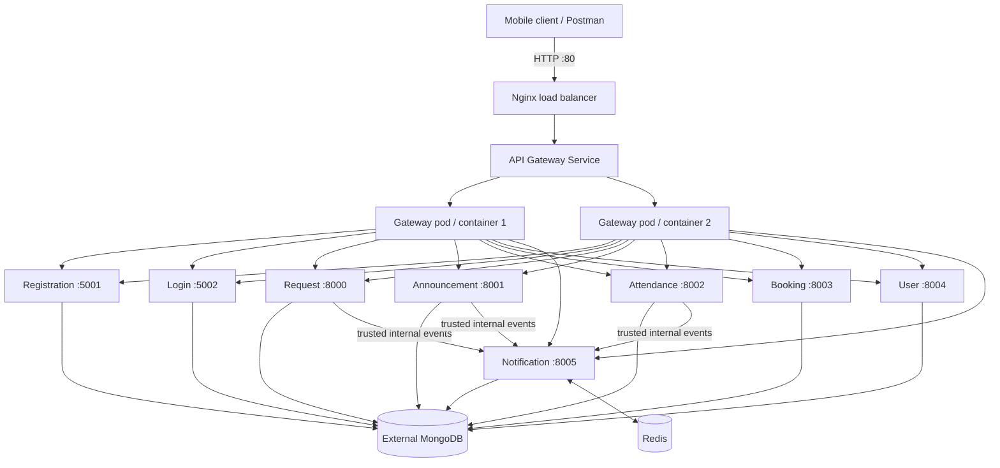

# American University of Phnom Penh

## OMS — Organization Management System

**CLD 376 — Cloud Native Development**  
**Prof. Chandan Mukherjee**  
**Fall 2026**

| Member | Student ID |
| --- | --- |
| Panhaseth SUY | 2024060 |
| Senghak CHOEUN | 2024010 |
| Sreypov THIM | 2024018 |

---

## Table of Contents

1. [Introduction](#1-introduction)
2. [Objective](#2-objective)
3. [Architecture Diagram](#3-architecture-diagram)
4. [Technologies / Tools](#4-technologies--tools)
5. [Microservice Details and API Reference](#5-microservice-details-and-api-reference)
6. [Pod and Container Details](#6-pod-and-container-details)
7. [Kubernetes Configuration](#7-kubernetes-configuration)
8. [Fanout Mechanism](#8-fanout-mechanism)
9. [Volume Implementation](#9-volume-implementation)
10. [Postman API Calls](#10-postman-api-calls)
11. [GitHub Link](#11-github-link)
12. [Individual Contribution](#12-individual-contribution)

## 1. Introduction

OMS is a containerized backend for organization operations. It provides account registration and login, user profiles and private documents, leave requests, announcements, attendance, in-app notifications, and room booking approval. It is API-only; a mobile client consumes the REST endpoints.

The active local deployment is Docker Compose. The repository also contains portable Kubernetes manifests under `deploy/k8s/`; they require image publication, secrets, and cluster validation before use.

## 2. Objective

- Separate business areas into independently deployable services.
- Provide JWT-protected REST APIs with user and administrator roles.
- Put Nginx and an API gateway in front of internal services.
- Support approval workflows for leave requests and room bookings.
- Deliver trusted in-app notifications through Redis-backed event processing.
- Persist business data in externally managed MongoDB.

## 3. Architecture Diagram



Nginx is the public entry point. Gateway replicas listen internally on port `4000`; Nginx or Kubernetes service discovery distributes traffic to them. MongoDB is external and is not provisioned by Compose or Kubernetes manifests.

## 4. Technologies / Tools

| Area | Technology |
| --- | --- |
| Node services | Node.js 24, Express, Mongoose |
| Python services | Python 3.12, FastAPI, Pydantic v2, Beanie |
| Persistence | External MongoDB |
| Caching/events | Redis Streams |
| Edge routing | Nginx, `http-proxy` API gateway |
| Authentication | JWT, bcrypt, role-based authorization |
| Packaging | Docker, Docker Compose |
| Kubernetes | Plain YAML and Kustomize |
| API verification | Postman, Node test runner, pytest |

## 5. Microservice Details and API Reference

Base public URL: `http://localhost`. Protected requests use `Authorization: Bearer <token>`.

| Service | Source directory | Port | Public prefix | Responsibility |
| --- | --- | ---: | --- | --- |
| Registration | `apps/registration-service` | 5001 | `/register` | Public user registration and internal account creation |
| Login | `apps/login-service` | 5002 | `/login` | Credential verification and JWT issue |
| Request | `apps/request-service` | 8000 | `/request` | Leave requests and approval workflow |
| Announcement | `apps/event-service` | 8001 | `/announcement` | Announcement publishing and images |
| Attendance | `apps/attendance-service` | 8002 | `/attendance` | Check-in, check-out, and corrections |
| Booking | `apps/library-service` | 8003 | `/booking` | Rooms and booking approval workflow |
| User | `apps/member-service` | 8004 | `/user` | Profiles, documents, account administration facade |
| Notification | `apps/notification-service` | 8005 | `/notification` | Notifications, preferences, Redis consumer |

### Gateway, registration, and login

| Method | Endpoint | Access | Description |
| --- | --- | --- | --- |
| GET | `/health` | Public | Gateway health |
| GET | `/register/health` | Public | Registration health |
| POST | `/register` | Public | Register a `user` account |
| GET | `/login/health` | Public | Login health |
| POST | `/login` | Public | Authenticate and receive a one-hour JWT |

### Requests

| Method | Endpoint | Access | Description |
| --- | --- | --- | --- |
| GET | `/request/health` | Public | Service health |
| POST, GET | `/request/leave-requests` | JWT | Create; users see their own records and admins see all |
| GET, PATCH | `/request/leave-requests/{id}` | Owner/admin; owner update | Read or update pending request |
| PATCH | `/request/leave-requests/{id}/cancel` | Owner | Cancel pending request |
| POST | `/request/leave-requests/{id}/approve` | Admin | Approve and notify the owner |
| POST | `/request/leave-requests/{id}/reject` | Admin | Reject and notify the owner |

### Announcements, attendance, and notifications

| Method | Endpoint | Access | Description |
| --- | --- | --- | --- |
| GET | `/announcement/health` | Public | Announcement health |
| POST, GET | `/announcement` | Admin write; JWT read | Create/list; non-admins see published records only |
| GET | `/announcement/all` | Admin | List every announcement status |
| GET, PATCH, DELETE | `/announcement/{id}` | JWT read; admin write | Read, update/publish, or delete |
| GET | `/attendance/health` | Public | Attendance health |
| POST | `/attendance/check-in`, `/attendance/check-out` | JWT | Current-user daily attendance |
| GET | `/attendance/me` | JWT | Current-user history |
| POST, GET | `/attendance` | Admin | Create or list administration records |
| GET, PATCH, DELETE | `/attendance/{id}` | Owner/admin read; admin write | Read, correct, or soft-delete |
| GET | `/notification/health` | Public | Notification/Redis health |
| POST, GET | `/notification` | Admin create; JWT list | Create or list accessible notifications |
| GET | `/notification/unread-count` | JWT | Current-user unread total |
| PATCH | `/notification/read-all`, `/notification/{id}/read` | JWT | Mark notifications read |
| GET, PATCH, DELETE | `/notification/{id}` | JWT read/delete; admin update | Read, update, or hide/delete |
| GET, PATCH | `/notification/preferences/me` | JWT | Notification preferences |

### Users and booking

| Method | Endpoint | Access | Description |
| --- | --- | --- | --- |
| GET | `/user/health` | Public | User service health |
| GET, PATCH | `/user/me` | JWT | Get/update own profile fields |
| POST, GET | `/user/me/documents` | JWT | Upload/list own documents |
| GET | `/user/me/documents/{id}/download` | Owner | Download own document |
| POST, GET | `/user` | Admin | Create or list accounts/profiles |
| GET, PATCH, DELETE | `/user/{id}` | Owner/admin read; admin write | Read, update, deactivate/soft-delete |
| GET | `/user/{id}/documents`, `/user/{id}/documents/{documentId}/download` | Owner/admin | Access document history/download |
| GET | `/booking/health` | Public | Booking health |
| POST, GET | `/booking/rooms` | Admin create; JWT list | Room administration and browsing |
| GET, PATCH, DELETE | `/booking/rooms/{id}` | JWT read; admin write | Room details, update, deactivate |
| GET | `/booking/rooms/{id}/availability` | JWT | Approved busy time slots |
| POST, GET | `/booking` | JWT create; admin list | Create pending booking or list all |
| GET | `/booking/me` | JWT | Current-user bookings |
| GET | `/booking/{id}` | Owner/admin | Booking details |
| POST | `/booking/{id}/cancel` | Owner/admin | Cancel eligible booking |
| POST | `/booking/{id}/approve`, `/booking/{id}/reject` | Admin | Resolve pending booking |

### Internal endpoints

| Method | Direct endpoint | Access | Description |
| --- | --- | --- | --- |
| POST | Registration `/internal/users` | Internal API key | Create account for User service |
| PATCH | Registration `/internal/users/{id}` | Internal API key | Update credentials metadata/active state |
| POST | Notification `/internal/events` | Internal API key | Receive trusted notification event |

## 6. Pod and Container Details

The local equivalent of a Pod is a Compose container. Kubernetes uses one Deployment per service; its Pod includes one application container. `api-gateway` has two replicas. Nginx, Redis, and each business service initially use one replica.

| Kubernetes workload | Container port | Kubernetes Service |
| --- | ---: | --- |
| nginx | 80 | LoadBalancer `nginx` |
| api-gateway | 4000 | ClusterIP `api-gateway` |
| registration/login | 5001/5002 | ClusterIP services |
| request/announcement/attendance | 8000/8001/8002 | ClusterIP services |
| booking/user/notification | 8003/8004/8005 | ClusterIP services |
| redis | 6379 | ClusterIP `redis` |

## 7. Kubernetes Configuration

Minikube-ready manifests are in `deploy/k8s/`. They use local images such as `oms-api-gateway:latest`, built into the Minikube image store by `./scripts/build-minikube-images.sh`.

### 7.1 Deployment YAML File

Each `*-service.yaml` contains a Deployment and a ClusterIP Service. `api-gateway.yaml` sets `replicas: 2`. `nginx.yaml` provides the public LoadBalancer Service. `redis.yaml` uses no persistence, matching Compose.

### 7.2 Service YAML File

Services provide DNS-based internal discovery. Configuration uses those names, for example `http://notification-service:8005`. Apply a real secret separately:

```bash
cp deploy/k8s/secret.example.yaml deploy/k8s/secret.yaml
# Replace placeholders; do not commit it.
kubectl apply -f deploy/k8s/secret.yaml
kubectl apply -k deploy/k8s
```

For Minikube, enable Ingress and map the required fanout DNS hostname:

```bash
minikube start
minikube addons enable ingress
./scripts/build-minikube-images.sh
echo "$(minikube ip) oms.aupp.local" | sudo tee -a /etc/hosts
curl -i http://oms.aupp.local/health
```

The Ingress routes `oms.aupp.local` to Nginx. Validate rendered manifests with `kubectl kustomize deploy/k8s`. These manifests still require valid secrets and a real cluster test.

## 8. Fanout Mechanism

**Request fanout:** `oms.aupp.local` resolves to Minikube and enters the Ingress/Nginx path. Nginx routes to the `api-gateway` Service. Kubernetes balances Service traffic between the two gateway Pods. Gateway health returns `X-Gateway-Instance`; repeated requests should show both Pod hostnames.

**Notification fanout:** Request approval/rejection, attendance corrections, and announcement publication call Notification’s private `/internal/events` endpoint using an internal API key. Notification writes to a Redis Stream and creates a direct or role-targeted notification. Role-targeted records fan out logically to all matching users while each user keeps separate read/delete receipt state.

## 9. Volume Implementation

| Data | Local Compose | Kubernetes |
| --- | --- | --- |
| Announcement uploads | `event_uploads` named volume | `announcement-uploads` PVC mounted at `/backend/uploads` |
| User documents | `member_uploads` named volume | `user-uploads` PVC mounted at `/backend/uploads` |
| MongoDB | External | External; no manifest provided |
| Redis | Ephemeral | Ephemeral; no PVC |

Nginx also uses an `emptyDir` shared by its main container and `log-reader` sidecar. Nginx writes `/shared-logs/access.log`; the sidecar tails the same file. This demonstrates multi-container shared-volume access within one Pod.

PVCs require a cluster StorageClass. `ReadWriteOnce` is appropriate for the single-replica upload services currently defined.

## 10. Postman API Calls

Import `docs/postman/OMS-Backend.postman_collection.json`. Capture real screenshots after configuring MongoDB and service secrets; screenshots are not stored in this repository.

Checklist:

- [ ] Nginx/gateway health and two upstream responses
- [ ] Registration and user/admin login
- [ ] Leave create, approve, reject, and notification result
- [ ] Announcement admin create/publish and user list
- [ ] Attendance check-in/out and admin correction
- [ ] Notification list/read/preferences
- [ ] User self-profile/document and admin account management
- [ ] Room create, booking create, approve/reject, availability

## 11. GitHub Link

<https://github.com/senghakch17-byte/AMT-MobileApp>

## 12. Individual Contribution

| Member | Assigned services |
| --- | --- |
| Panhaseth SUY | Attendance, Notification |
| Senghak CHOEUN | Announcement, Request |
| Sreypov THIM | Booking, User |

Gateway, Registration, Login, Compose/Kubernetes configuration, documentation, and integrated testing are shared team responsibilities.

## 13. Deployment Evidence, Challenges, and Conclusion

### Deployment evidence to capture

Insert readable, captioned screenshots after the real Minikube deployment:

1. `minikube status`
2. `kubectl get pods -n oms -o wide`
3. `kubectl get deployment,service,ingress,pvc -n oms`
4. Two `curl -i http://oms.aupp.local/health` results with different `X-Gateway-Instance` values
5. `kubectl logs -n oms deployment/nginx -c log-reader` after an HTTP request
6. MongoDB Atlas connection evidence without secrets
7. Postman requests listed in section 10

### Expected challenges and solutions

| Challenge | Resolution |
| --- | --- |
| Image pull failures | Build images with `./scripts/build-minikube-images.sh`; manifests use `imagePullPolicy: IfNotPresent`. |
| Ingress hostname does not resolve | Enable the Minikube Ingress addon and map `$(minikube ip)` to `oms.aupp.local` in `/etc/hosts`. |
| Pods cannot connect to MongoDB | Verify Atlas IP allowlist, URI, credentials, and Kubernetes secret values. |
| Upload PVC remains Pending | Verify a default StorageClass or specify `storageClassName`. |
| Gateway health appears to use one replica | Repeat requests and compare `X-Gateway-Instance`; inspect endpoints with `kubectl get endpoints -n oms api-gateway`. |

### Conclusion

OMS applies microservice boundaries, containerized deployment, gateway-based routing, external database connectivity, Kubernetes Deployments and Services, host-based DNS, and shared-volume logging. Final assessment evidence must come from the team's real Minikube deployment and tested API workflows; do not claim those results until captured.

## Configuration, Security, and Verification

MongoDB URI, JWT secret, and internal API key must be environment variables. Do not commit `.env` files or real Kubernetes secrets. Public registration always creates a `user`; only administrators use User-service account administration. JWT protects public APIs and the internal API key protects service-to-service calls.

Run locally:

```bash
docker compose config
docker compose up --build
./test-all.sh
```

Known limitations: Compose and Kubernetes do not provision MongoDB; `depends_on` does not prove readiness; Kubernetes manifests require a secret, PVC storage, and real-cluster validation; EC2 deployment files remain incomplete and unverified for production.
